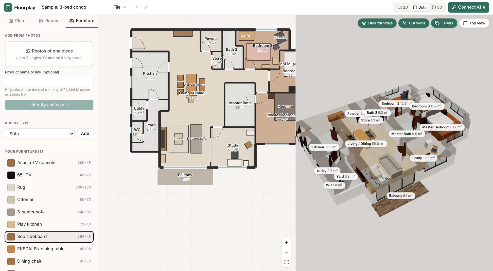

# Floorplay

**See your new home in 3D before you move in.** Upload a floor plan, add your own furniture from photos, and find out what fits.

Floorplay is a free, open-source web app. It runs entirely in your browser with your own AI key: there is no Floorplay server, account or subscription.

**Open it:** https://junglebabydev.github.io/floorplay/ · **Try the sample:** https://junglebabydev.github.io/floorplay/app/?sample=1



## How it works

Three uploads and one button:

1. **Floor plan.** A brochure page, a photo of a printed plan or a screenshot.
2. **Photos and videos of the home** (optional). A walkthrough video or room photos. Videos are sampled into still frames in the browser.
3. **Your furniture.** One photo per piece, with the product name if you know it.

Press **Process** and Floorplay:

- traces the walls, doors, windows and rooms, scaled from printed dimensions or room areas;
- matches each room's floor and wall colours from your photos and video;
- identifies every piece of furniture and its size (published dimensions when it recognises the product) and which room it belongs in;
- arranges the pieces: rugs and tables in the middle, chairs around the table, everything else against a wall facing into the room, clear of doors and each other.

You land on the furnished home in 2D and 3D. Drag, rotate or resize anything; overlaps, pieces in walls and blocked doors show in red, and **Hide furniture** shows the empty home. The full editor (walls, doors, windows, rooms, set scale) is there for anything the AI got wrong. Projects autosave in the browser, save to a file, and export as `.glb`.

You can also draw a plan entirely by hand with no AI at all.

## Bring your own AI

Pick a provider in **Connect AI** and paste a key. Use a model that can read images.

| Provider | Notes |
| --- | --- |
| Anthropic | Claude models via the official SDK. Default `claude-opus-5-5`. |
| OpenAI | GPT models with strict JSON output. |
| Google Gemini | Key from Google AI Studio. |
| OpenRouter | One key for many providers' models. |
| Local or custom | Any OpenAI-compatible server: Ollama, LM Studio, vLLM and others. Start Ollama with `OLLAMA_ORIGINS` set so the page can reach it. |

**Privacy.** Keys and projects are stored only in your browser (localStorage and IndexedDB). AI requests go directly from your browser to the provider you chose. Use **Forget keys** on a shared computer.

**Why not a ChatGPT or Claude subscription?** Anthropic does not allow Claude Pro or Max subscriptions to be used in third-party apps, and OpenAI's Sign in with ChatGPT is limited to its partner programme. Both offer pay-as-you-go API keys, which work here. A Floorplay app that runs inside ChatGPT and Claude (an MCP App), using the user's subscription there, is on the roadmap.

## Develop

Requires Node 22 and pnpm.

```bash
pnpm install
pnpm dev        # http://localhost:5173 (landing) and /app/
pnpm test       # unit tests (vitest)
pnpm typecheck
pnpm build      # static site in dist/
```

The build is a static site with a relative base, so `dist/` can be hosted anywhere. GitHub Pages deploys it from `main` (see `.github/workflows/pages.yml`).

### Layout

| Path | What lives there |
| --- | --- |
| `src/core` | The plan model, geometry (areas, wall openings, clashes, snapping), AI-trace normalisation and the sample home. No UI or three.js. |
| `src/ai` | Provider clients, prompts, JSON schemas and validators for the three AI jobs: trace a plan, identify furniture, read a room's finish. |
| `src/three` | Plan to three.js: walls with openings, doors, windows, procedural floor textures, parametric furniture, `.glb` export. |
| `src/app` | The React app: store, 2D plan editor (SVG), 3D view (react-three-fiber), panels and settings. |
| `index.html` | The landing page. |

`src/core`, `src/ai` and `src/three` are framework-free so they can be reused, for example in an MCP App.

## Roadmap

- Floorplay as an MCP App for ChatGPT and Claude, so people can use their existing subscriptions.
- Desktop builds (Tauri) for offline use with local models.
- More furniture shapes, wall colours per room, multi-storey homes.
- Share a read-only link to a furnished plan.

## Licence

MIT. See [LICENSE](LICENSE). The bundled sample home is traced from a real condo plan; the developer's brochure image is not included.
